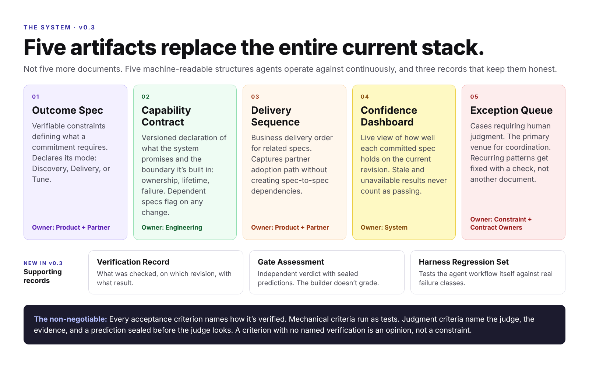

# Agentic Flow Templates

*The post-agentic SDLC, as templates. Current version: v0.3.*



**Five artifacts replace the entire current stack.**

Not five more documents. Five machine-readable structures that agents operate against continuously.

---

## The Problem

Every software methodology we have — waterfall, Agile, SAFe — was invented to solve the same problem.

*Code is expensive. How do we make sure we write the right code?*

User stories. Sprints. Story points. Acceptance criteria. PRDs. All of it is an answer to that one constraint.

AI just made that constraint obsolete.

When agent teams can generate, test, and iterate on code continuously, the bottleneck shifts. The question stops being *did we build the thing* and becomes *does the thing satisfy what we committed to.*

User stories cannot answer that question. They were never designed to.

---

## The Five Artifacts

| # | Artifact | Replaces | Owner |
|---|----------|----------|-------|
| 01 | [Outcome Spec](templates/outcome-spec.md) | User story + PRD | Product + Partner |
| 02 | [Capability Contract](templates/capability-contract.md) | SRD + implicit dependency web | Engineering |
| 03 | [Delivery Sequence](templates/delivery-sequence.md) | Roadmap + release plan | Product + Partner |
| 04 | [Confidence Dashboard](templates/confidence-dashboard.md) | Status meetings + TPM tracking | System |
| 05 | [Exception Queue](templates/exception-queue.md) | Standups + Slack coordination | Constraint + Contract Owners |

---

## The Non-Negotiable

Every acceptance criterion names how it is verified. If a criterion has no named verification, it is not a constraint — it is an opinion.

Mechanical criteria run as tests, and agents evaluate them autonomously. Some outcomes are judgments: whether an experience works, whether a tradeoff is right. Those name the judge, the evidence, and a prediction an independent evaluator records before the judge looks. What they never do is sit in the spec as unverified prose. The moment that happens, you've rebuilt the old model with a new name.

## Three Modes

An Outcome Spec declares what "done" means for it.

| Mode | When | Done means |
|------|------|-----------|
| **Discovery** | The outcome isn't known yet. The spec is the output of the work, not the input. | A decision: keep, change, or cut. Claims carry confirming and contradicting signals, an exposure condition, and a run cap, all written before the run. |
| **Delivery** | The outcome is chosen. | Every acceptance constraint passes on a named revision, and the human decisions are recorded. |
| **Tune** | The design is settled and the systems exist. | Constraints hold after value changes. A structural change is proposed only when no value in range gets there. |

Don't silently promote a Discovery spec into a Delivery commitment, and don't treat a settled design as a hypothesis.

---

## Supporting Records

The five artifacts say what is committed and how it's going. These three records are the evidence underneath them. They don't replace anything; they keep the five honest.

| Record | Purpose |
|--------|---------|
| [Verification Record](templates/verification-record.md) | What was actually checked, on which revision, with what result. Stale and Unavailable are first-class states. |
| [Gate Assessment](templates/gate-assessment.md) | An independent verdict on a judgment constraint, with sealed predictions compared against the human afterward. The builder doesn't grade. |
| [Harness Regression Set](templates/harness-regression.md) | Evaluates the agent workflow itself against real failure classes, with calibrated graders and repeated trials. |

### Rules the records enforce

- **Evidence is bound to a revision.** Change a relevant source, contract, data file, or tool version and affected results go stale until rerun.
- **Documentation is not enforcement.** A check is Enforced only when the actual merge or status path runs it. Everything else is Advisory or Planned, and the dashboard says which.
- **Contracts come before implementation.** Agents read the applicable Capability Contract before choosing how to build. Existing violations are tracked debt, not retroactive passes.
- **Lessons become checks, not paragraphs.** A recurring escape gets an interface change or a check, plus a test showing the check catches it.

---

## How the Artifacts Relate

```
Outcome Spec
  └── depends on → Capability Contract(s)
                       └── when changed → flags dependent Outcome Specs

Delivery Sequence
  └── orders → Outcome Specs (by partner adoption stage)
  └── no direct spec-to-spec dependencies — all mediated through Contracts

Confidence Dashboard
  └── evaluates → all active Outcome Specs
  └── surfaces → Exception Queue entries

Exception Queue
  └── receives → cases agents cannot resolve
  └── resolved by → Constraint + Contract Owners
  └── closes loop → back to Outcome Spec or Capability Contract update

Verification Record
  └── binds → Outcome Spec and Contract results to a revision
  └── feeds → Confidence Dashboard (stale or unavailable results never count as passing)

Gate Assessment
  └── evaluates → judgment constraints, independently of the builder
  └── calibrates → future assessments against the human's decision
```

---

## Where to Start

Take one active user story. Rewrite the acceptance criteria so every single one names how it is verified.

Not *"the user can complete onboarding."* That is an opinion.

*"A new user with no prior account completes onboarding in under 4 minutes with zero support interactions."* That is a constraint, and it runs as a test.

Some criteria are judgments and won't reduce to a test. For those, name the judge, the evidence they decide from, and who records a prediction before the judge looks.

If you cannot say how a criterion gets verified, you do not yet know what you are building. That is useful information.

---

## Templates

- [Outcome Spec](templates/outcome-spec.md)
- [Capability Contract](templates/capability-contract.md)
- [Delivery Sequence](templates/delivery-sequence.md)
- [Confidence Dashboard](templates/confidence-dashboard.md)
- [Exception Queue](templates/exception-queue.md)
- [Verification Record](templates/verification-record.md)
- [Gate Assessment](templates/gate-assessment.md)
- [Harness Regression Set](templates/harness-regression.md)

---

## Examples

- **[Indie Game Outcomes](https://github.com/theronjames-dev/indie-game-outcomes)** — Agentic Flow applied to indie game development as an AI skill: discovery experiments, whole-experience tuning, independent gates with sealed predictions, and engineering contracts.

---

## Background

These templates started with **[The User Story Is Dead](https://theronjames.substack.com/p/the-user-story-is-dead)** and evolved through use. The argument behind them:

- [Agentic Flow](https://theronjames.substack.com/p/agentic-flow) — the operating model for teams where agents do real work
- [The Code Is No Longer the Artifact](https://theronjames.substack.com/p/the-code-is-no-longer-the-artifact) — why the spec and verification layer is what lasts
- [The Factory That Can't Fail](https://theronjames.substack.com/p/the-factory-that-cant-fail) — prevention over inspection, and the zero-discovery metric
- [Game Prototypes Don't Belong on a Feature Board](https://theronjames.substack.com/p/game-prototypes-dont-belong-on-a) — discovery work closes on decisions, not merges

See [CHANGELOG.md](CHANGELOG.md) for what changed and why.

---

## License

MIT. Use freely. Adapt to your context. If you build something interesting on top of this, share it.

---

*Built by [Theron James](https://theronjames.substack.com)*
